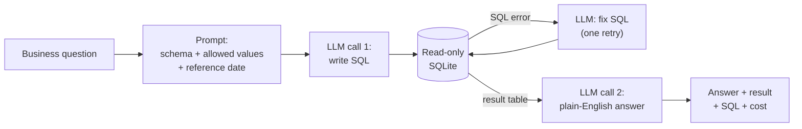

# Logistics Ops Copilot

**Ask operational questions about a first-mile parcel network in plain English, and get
answers backed by SQL, in seconds instead of a ticket to the data team.**

---

## The problem

In a first-mile network, the people running operations need numbers every day:

| Role | Typical question |
|---|---|
| Truck Planner | Which milkruns arrive late most often, and which pickup stop causes it? |
| Account Manager | Which of my shippers caused wasted trucks or ad-hoc trucks last quarter? |
| Forecasting Manager | Which shippers missed the ±10% attainment band for 3+ weeks? |
| Node Manager | On how many peak days did my node receive more pallets than its capacity? |
| Inventory Planner | How much volume arrived on bank holidays with no forecast? |

Most of these are one-off questions that no dashboard covers, so they queue behind the
data analytics team. During peak, when the answers matter most, that queue is longest.
The goal is self-serve answers for the long tail of ad-hoc questions, ready before the
next peak, with dashboards kept for the recurring KPIs.

## Example

```
$ python copilot.py "How many shipments were cancelled last quarter?"

A: Last quarter (July 1 to September 30, 2026), 946 shipments were cancelled.
   The count includes only shipments whose status is "Cancelled" and whose
   creation date falls within that three-month window.

Result (1 rows):
 cancelled_shipments
                 946

SQL:
SELECT COUNT(*) AS cancelled_shipments
FROM shipments
WHERE status = 'Cancelled'
  AND created_date >= '2026-07-01'
  AND created_date < '2026-10-01';

Cost: $0.00034   Time: 2.7s
```

The answer states its time period and filters, and shows the SQL, so the data team can
verify any number.

## How it works



- **Context from the database itself:** table schemas and the exact values of category
  columns are read at runtime, so the prompt never goes stale.
- **Read-only connection:** AI-written SQL cannot change data, whatever the prompt says.
- **Bounded self-correction:** a failing query is sent back to the model with the error,
  once. If it still fails, the user gets "I couldn't answer this", not a guess.
- **Two calls, two jobs:** one writes SQL; the other explains the result and may only
  use numbers that appear in it.

Model: Claude Haiku 5.5 (`claude-haiku-5-5`).

## The data

A synthetic European first-mile network (UK, FR, IT, ES), modelled on real operations:
shippers, pickup truck runs (direct and milkrun), delivery nodes, daily pickup forecasts,
bank holidays and exceptions, from Jan 2025 to Sep 2026.

| | |
|---|---|
| Shippers | 1,000, with 25 Account Managers |
| Nodes | 40 |
| Truck runs | ~293,000 |
| Shipments | ~411,000 |
| Daily forecasts | ~369,000 |

The data contains planted operational patterns with known answers (e.g. UK-only customs
holds, a node that overflows in peak, shippers that close without notice, slow-loading
milkrun stops), so accuracy can be measured against ground truth.
Data model and business definitions: [`docs/data_model.md`](docs/data_model.md).
Generate it with `python generate_data.py` (reproducible, seed 42).

## Results

Evaluated on 15 golden questions with verified answers ([`evals/`](evals/)).
A question passes if the copilot's result contains the correct answer values,
regardless of column names, row order or rounding.

| Version | Overall | Easy | Medium | Hard | Cost / question | Avg time |
|---|---|---|---|---|---|---|
| v0 (schema only) | **6 / 15 (40%)** | 5 / 5 | 1 / 5 | 0 / 5 | $0.0009 | 6.6 s |

**What fails, and why** (full analysis: [`evals/baseline_analysis.md`](evals/baseline_analysis.md)):

- **7 of 9 failures are business definitions, not SQL skill.** The model writes valid
  SQL, but it doesn't know that on-time is measured against all non-cancelled shipments,
  that attainment uses pickup date and Sunday–Saturday weeks, or that avoidable cost
  includes the ad-hoc truck premium.
- **The most dangerous failure returned no rows.** "No shipper causes late milkruns"
  reads as good news, not as a wrong join.
- **Results vary between runs** for the same question, so evals are re-run after every change.

## Next

| Change | Targets |
|---|---|
| Business glossary + worked examples in the prompt | Definition and date-logic failures |
| Semantic layer: SQL views for on-time, attainment, utilisation, avoidable cost | Makes definitions deterministic instead of relying on the model |
| SQL guardrails: SELECT-only check, row limit, timeout | Safety |
| Answers state their assumptions; ambiguous questions get a clarifying question | Trust |
| Expand to 50 golden questions; compare models on accuracy, cost and latency | Evidence-based model choice |

## Run it

Requires Python 3.10+ and an Anthropic API key.

```bash
git clone https://github.com/siddhartha2312/logistics-ops-copilot.git
cd logistics-ops-copilot
python3 -m venv .venv && source .venv/bin/activate
pip install -r requirements.txt

cp .env.example .env          # then add your ANTHROPIC_API_KEY
python generate_data.py       # builds logistics.db (~1 min)

python copilot.py "Which carrier had the most late arrivals in September 2026?"
python evals/run_evals.py     # score against the golden questions
```

## Repository

```
copilot.py              question → SQL → read-only run → answer
generate_data.py        builds the synthetic network (seed 42)
docs/data_model.md      tables, business definitions, planted scenarios
evals/
  golden_queries.sql    ground-truth SQL for each question
  build_golden.py       runs it and stores the answers
  compare.py            decides whether a result matches the golden answer
  run_evals.py          runs all questions through the copilot and scores them
  baseline_analysis.md  v0 results and failure analysis
```

## License

MIT