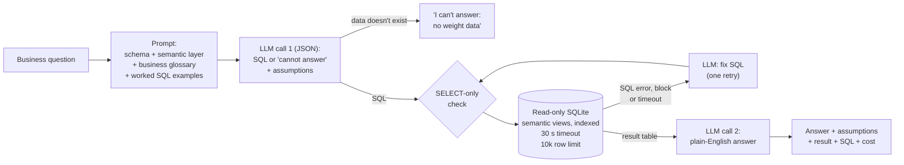

# Logistics Ops Copilot

**Ask operational questions about a first-mile parcel network in plain English, and get
answers backed by SQL, in seconds instead of a ticket to the data team.**

---

## The problem

In a first-mile network, the people running operations need numbers every day:

| Role | Typical question |
|---|---|
| Truck Planner | Which milkruns arrive late most often, and which pickup stop causes it? |
| Account Manager | Which of my shippers caused wasted trucks or ad-hoc trucks last quarter? |
| Forecasting Manager | Which shippers missed the ±10% attainment band for 3+ weeks? |
| Node Manager | On how many peak days did my node receive more pallets than its capacity? |
| Inventory Planner | How much volume arrived on bank holidays with no forecast? |

Most of these are one-off questions that no dashboard covers, so they queue behind the
data analytics team. During peak, when the answers matter most, that queue is longest.
The goal is self-serve answers for the long tail of ad-hoc questions, ready before the
next peak, with dashboards kept for the recurring KPIs.

## Example

```
$ python copilot.py "How many shipments were cancelled last quarter?"

A: Last quarter (July 1 to September 30, 2026), 946 shipments were cancelled.
   The count includes only shipments whose status is "Cancelled" and whose
   creation date falls within that three-month window.

Result (1 rows):
 cancelled_shipments
                 946

SQL:
SELECT COUNT(*) AS cancelled_shipments
FROM shipments
WHERE status = 'Cancelled'
  AND created_date >= '2026-07-01'
  AND created_date < '2026-10-01';

Cost: $0.00034   Time: 2.7s
```

The answer states its time period and filters, and shows the SQL, so the data team can
verify any number.

## How it works



- **Context from the database itself:** table schemas and the exact values of category
  columns are read at runtime, so the prompt never goes stale.
- **Semantic layer:** four verified views (`v_shipments`, `v_attainment_daily`,
  `v_truck_runs`, `v_shipper_avoidable_cost`) hold the business definitions as SQL, with
  tests that they reproduce known answers ([`docs/semantic_layer.md`](docs/semantic_layer.md)).
  The copilot filters and groups them instead of rebuilding the logic.
- **Business glossary:** the agreed meaning of every metric (on-time, attainment,
  utilisation, avoidable cost, Sunday–Saturday weeks, pickup date) is sent with every
  question ([`docs/glossary.md`](docs/glossary.md)), with three worked SQL patterns
  ([`docs/sql_examples.md`](docs/sql_examples.md)).
- **Honest refusals:** the model replies in JSON with either SQL or `cannot_answer`. If
  the question needs data that doesn't exist, it says which data is missing instead of
  answering with a substitute.
- **Visible assumptions:** every interpretation the glossary doesn't settle ("recently"
  = Sep vs Aug 2026, "big drop" = 20%+) is listed under the answer.
- **Safety in layers:** a read-only connection, plus a check that rejects anything
  but a single SELECT before it reaches the database, plus a 10,000-row limit.
- **Time limits:** any query is stopped after 30 s and any model call after 60 s. The
  database is indexed, so well-meant but clumsy queries rarely get near the limit.
- **Bounded self-correction:** a failing or blocked query is sent back to the model with
  the error, once. If it still fails, the user gets "I couldn't answer this", not a guess.
- **Every question is logged** (question, SQL, assumptions, outcome, answer, tokens, cost,
  time per stage, prompt version) to a JSON Lines file; result rows are never logged.
  `log_report.py` summarises usage, cost, speed, refusals and which views answer
  questions. On AWS this maps to CloudWatch Logs and Athena.
- **Two calls, two jobs:** one writes SQL; the other explains the result, may only use
  numbers that appear in it, and gives the full row count (long results are saved to CSV).

Model: Claude Haiku 5.5 (`claude-haiku-5-5`).

## The data

A synthetic European first-mile network (UK, FR, IT, ES), modelled on real operations:
shippers, pickup truck runs (direct and milkrun), delivery nodes, daily pickup forecasts,
bank holidays and exceptions, from Jan 2025 to Sep 2026.

| | |
|---|---|
| Shippers | 1,000, with 25 Account Managers |
| Nodes | 40 |
| Truck runs | ~293,000 |
| Shipments | ~411,000 |
| Daily forecasts | ~369,000 |

The data contains planted operational patterns with known answers (e.g. UK-only customs
holds, a node that overflows in peak, shippers that close without notice, slow-loading
milkrun stops), so accuracy can be measured against ground truth.
Data model and business definitions: [`docs/data_model.md`](docs/data_model.md).
Generate it with `python generate_data.py` (reproducible, seed 42).

## Results

Evaluated on two question sets with verified answers ([`evals/`](evals/)).
A question passes if the copilot's result contains the correct answer values,
regardless of column names, row order or rounding.

- **Dev set (15 questions):** used to find failures and write the glossary.
- **Held-out set (10 questions):** written separately by the domain owner, never used
  to tune the copilot. Two ask for data that does not exist, to test whether the
  copilot says so.

| Version | What changed | Dev | Held-out | Cost / question | Avg time |
|---|---|---|---|---|---|
| v0 | Schema + allowed values only | 5 / 15 (33%) | – | $0.0009 | 6.6 s |
| v1 | + business glossary + worked examples + timeouts | 15 / 15 (100%), 3 runs out of 3 | 5 / 10 (50%) | $0.0012–0.0016 | 7–10 s |
| v2 | + JSON reply with honest refusals and assumptions, SELECT-only check, row limit, indexes | 15 / 15 (100%) | 7–8 / 10 (70–80%), 2 runs | $0.0014 | 7.7 s |
| v3 | + semantic layer: verified SQL views for the business definitions | 15 / 15 (100%) | 8 / 10 (80%) | $0.0015 | 7.8 s |
| v3.1 | + glossary gaps closed (week numbers, node closures, unforecast days), 3 more views | **20 / 20 (100%)** | refresh pending | $0.0016 | 7.7 s |

All scores use the current answer key and judge ([change log](evals/golden_changes.md)).
In v3.1, four held-out questions moved to the dev set once their definitions were added
to the glossary, so they no longer count as unseen; a fresh held-out set replaces them.

**What the v0 failures showed** ([analysis](evals/baseline_analysis.md)):
7 of 9 failures were business definitions, not SQL skill. A glossary of agreed
definitions and three worked SQL patterns fixed all of them on the dev set.

**What the held-out set showed** ([analysis](evals/heldout_results.md)):
- **3 of 5 failures: the copilot never says "I can't answer".** Asked which trucks were
  over their weight limit (there is no weight data), it used pallet capacity instead
  and answered "none": a confident, wrong all-clear.
- **2 of 5: terms the glossary doesn't define** ("week 20", days with volume but no
  forecast).
- No failure was bad SQL, and every definition already in the glossary was applied
  correctly.

**What v2 fixed** ([analysis](evals/v2_results.md)):
- Both missing-data questions are now refused, naming the missing field ("no weight
  data; truck runs hold pallet capacity and pallets loaded"). No answerable dev
  question was refused.
- The slowest question went from 44 s (timeout + retry) to under 19 s: the database had
  no indexes. A speed problem in the data, not the model.
- The remaining held-out failures are all undefined business terms (week numbering,
  what "closed" means for a node, days with volume but no forecast). Because they're
  undefined, the model picks a different reading from run to run.

**What v3 changed** ([analysis](evals/v3_results.md)): accuracy stayed the same, but
the business logic moved out of the AI's SQL into tested views (four, then seven in v3.1). The AI now writes
71% fewer joins and no business rules (CASE logic 4 → 0); weekly attainment went from
29 lines of SQL to 9. New questions have far fewer places to go wrong, and the copilot
reads the same definitions a dashboard would.

The gap between dev and held-out is the point of the held-out set: dev accuracy measures
how well the copilot was fitted, held-out accuracy estimates what a user would see.

## What the logs show (20-question run, v3.1)

| | |
|---|---|
| Cost | **$1.61 per 1,000 questions**; ~60% of it is the fixed prompt (caching target) |
| Time per question | 7.1 s average, 15.3 s at the 95th percentile |
| Where the time goes | Writing SQL 64% · writing the answer 30% · **running SQL 5%** |
| Semantic layer coverage | **90%** of answers use a view; the rest are simple lookups |

The database is no longer the bottleneck; speed and cost now depend on the model calls.

## Next

| Change | Targets |
|---|---|
| Fresh held-out set (50 questions in total), including more questions the data can't answer | Honest re-measurement after v3.1 |
| Ask a clarifying question when a term is ambiguous and the answer depends on it | Trust |
| Prompt caching for the fixed prompt (~8–9k tokens per call) | Cost |
| Compare models on accuracy, cost and latency | Evidence-based model choice |

## Run it

Requires Python 3.10+ and an Anthropic API key.

```bash
git clone https://github.com/siddhartha2312/logistics-ops-copilot.git
cd logistics-ops-copilot
python3 -m venv .venv && source .venv/bin/activate
pip install -r requirements.txt

cp .env.example .env          # then add your ANTHROPIC_API_KEY
python generate_data.py       # builds logistics.db with views (~1 min)
python db/test_semantic.py    # checks the views
python evals/build_golden.py && python evals/build_golden.py --set heldout

python copilot.py "Which carrier had the most late arrivals in September 2026?"
python evals/run_evals.py                 # score the dev set
python evals/run_evals.py --set heldout   # score the held-out set
```

## Repository

```
copilot.py              question → SQL → read-only run → answer (logged)
log_report.py           usage, cost, speed and outcomes from the call log
generate_data.py        builds the synthetic network (seed 42)
docs/data_model.md      tables, business definitions, planted scenarios
docs/semantic_layer.md  what each view and column means, sent with every question
docs/glossary.md        agreed metric definitions, sent with every question
docs/sql_examples.md    worked SQL patterns, sent with every question
db/
  semantic.sql          the semantic layer views (built by generate_data.py)
  test_semantic.py      tests that the views reproduce known answers
evals/
  golden_queries.sql    ground-truth SQL for the dev questions
  heldout_queries.sql   ground-truth SQL for the held-out questions
  build_golden.py       runs it and stores the answers
  compare.py            decides whether a result matches the golden answer
  run_evals.py          runs all questions through the copilot and scores them
  rescore.py            re-scores a saved run against the current answer key
  baseline_analysis.md  v0 results and failure analysis
  v1_results.md         v1 results and what changed
  heldout_results.md    v1 on the held-out set and failure analysis
  v2_results.md         v2 results: refusals, assumptions, guardrails
  v3_results.md         v3 results: semantic layer
  golden_changes.md     log of every answer-key change
```

## License

MIT