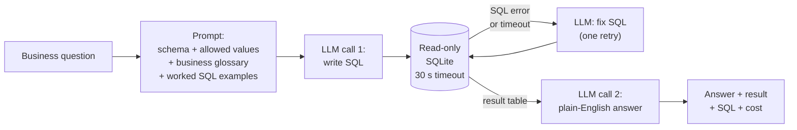

# Logistics Ops Copilot

**Ask operational questions about a first-mile parcel network in plain English, and get
answers backed by SQL, in seconds instead of a ticket to the data team.**

---

## The problem

In a first-mile network, the people running operations need numbers every day:

| Role | Typical question |
|---|---|
| Truck Planner | Which milkruns arrive late most often, and which pickup stop causes it? |
| Account Manager | Which of my shippers caused wasted trucks or ad-hoc trucks last quarter? |
| Forecasting Manager | Which shippers missed the ±10% attainment band for 3+ weeks? |
| Node Manager | On how many peak days did my node receive more pallets than its capacity? |
| Inventory Planner | How much volume arrived on bank holidays with no forecast? |

Most of these are one-off questions that no dashboard covers, so they queue behind the
data analytics team. During peak, when the answers matter most, that queue is longest.
The goal is self-serve answers for the long tail of ad-hoc questions, ready before the
next peak, with dashboards kept for the recurring KPIs.

## Example

```
$ python copilot.py "How many shipments were cancelled last quarter?"

A: Last quarter (July 1 to September 30, 2026), 946 shipments were cancelled.
   The count includes only shipments whose status is "Cancelled" and whose
   creation date falls within that three-month window.

Result (1 rows):
 cancelled_shipments
                 946

SQL:
SELECT COUNT(*) AS cancelled_shipments
FROM shipments
WHERE status = 'Cancelled'
  AND created_date >= '2026-07-01'
  AND created_date < '2026-10-01';

Cost: $0.00034   Time: 2.7s
```

The answer states its time period and filters, and shows the SQL, so the data team can
verify any number.

## How it works



- **Context from the database itself:** table schemas and the exact values of category
  columns are read at runtime, so the prompt never goes stale.
- **Business glossary:** the agreed meaning of every metric (on-time, attainment,
  utilisation, avoidable cost, Sunday–Saturday weeks, pickup date) is sent with every
  question ([`docs/glossary.md`](docs/glossary.md)), with three worked SQL patterns
  ([`docs/sql_examples.md`](docs/sql_examples.md)).
- **Read-only connection:** AI-written SQL cannot change data, whatever the prompt says.
- **Time limits:** any query is stopped after 30 s and any model call after 60 s.
  The timeout message tells the model how to rewrite the query efficiently for the retry.
- **Bounded self-correction:** a failing query is sent back to the model with the error,
  once. If it still fails, the user gets "I couldn't answer this", not a guess.
- **Two calls, two jobs:** one writes SQL; the other explains the result and may only
  use numbers that appear in it.

Model: Claude Haiku 5.5 (`claude-haiku-5-5`).

## The data

A synthetic European first-mile network (UK, FR, IT, ES), modelled on real operations:
shippers, pickup truck runs (direct and milkrun), delivery nodes, daily pickup forecasts,
bank holidays and exceptions, from Jan 2025 to Sep 2026.

| | |
|---|---|
| Shippers | 1,000, with 25 Account Managers |
| Nodes | 40 |
| Truck runs | ~293,000 |
| Shipments | ~411,000 |
| Daily forecasts | ~369,000 |

The data contains planted operational patterns with known answers (e.g. UK-only customs
holds, a node that overflows in peak, shippers that close without notice, slow-loading
milkrun stops), so accuracy can be measured against ground truth.
Data model and business definitions: [`docs/data_model.md`](docs/data_model.md).
Generate it with `python generate_data.py` (reproducible, seed 42).

## Results

Evaluated on 15 golden questions with verified answers ([`evals/`](evals/)).
A question passes if the copilot's result contains the correct answer values,
regardless of column names, row order or rounding. Both versions are scored against
the same answer key ([change log](evals/golden_changes.md)).

| Version | What changed | Score | Easy | Medium | Hard | Cost / question | Avg time |
|---|---|---|---|---|---|---|---|
| v0 | Schema + allowed values only | **5 / 15 (33%)** | 4 / 5 | 1 / 5 | 0 / 5 | $0.0009 | 6.6 s |
| v1 | + business glossary + worked examples + timeouts | **15 / 15 (100%)**, 3 runs out of 3 | 5 / 5 | 5 / 5 | 5 / 5 | $0.0012 | 7.2–8.2 s |

**What the v0 failures showed** ([full analysis](evals/baseline_analysis.md)):
7 of 9 failures were business definitions, not SQL skill. The model wrote valid SQL
but didn't know how this business defines on-time, attainment, utilisation or avoidable
cost. The most dangerous failure returned no rows, which read as good news.

**What fixed them:** a glossary of agreed definitions and three worked SQL patterns.
The examples deliberately use different questions from the evaluation set.

**Limits of this result:**
- 100% is on the development set: the glossary was written from these questions'
  failures, so accuracy on new questions will be lower. A held-out set is next.
- The slowest question once took 43 s (a slow query hit the 30 s timeout, then the retry
  passed). Accuracy is stable across runs; latency is not yet.

## Next

| Change | Targets |
|---|---|
| Held-out questions (~50 total), never used to write the glossary | Honest accuracy on unseen questions |
| Semantic layer: SQL views for on-time, attainment, utilisation, avoidable cost | Deterministic definitions; faster, simpler queries |
| SQL guardrails: SELECT-only check, row limit | Safety |
| Answers state their assumptions; ambiguous questions get a clarifying question | Trust |
| Compare models on accuracy, cost and latency | Evidence-based model choice |

## Run it

Requires Python 3.10+ and an Anthropic API key.

```bash
git clone https://github.com/siddhartha2312/logistics-ops-copilot.git
cd logistics-ops-copilot
python3 -m venv .venv && source .venv/bin/activate
pip install -r requirements.txt

cp .env.example .env          # then add your ANTHROPIC_API_KEY
python generate_data.py       # builds logistics.db (~1 min)

python copilot.py "Which carrier had the most late arrivals in September 2026?"
python evals/run_evals.py     # score against the golden questions
```

## Repository

```
copilot.py              question → SQL → read-only run → answer
generate_data.py        builds the synthetic network (seed 42)
docs/data_model.md      tables, business definitions, planted scenarios
docs/glossary.md        agreed metric definitions, sent with every question
docs/sql_examples.md    worked SQL patterns, sent with every question
evals/
  golden_queries.sql    ground-truth SQL for each question
  build_golden.py       runs it and stores the answers
  compare.py            decides whether a result matches the golden answer
  run_evals.py          runs all questions through the copilot and scores them
  rescore.py            re-scores a saved run against the current answer key
  baseline_analysis.md  v0 results and failure analysis
  v1_results.md         v1 results and what changed
  golden_changes.md     log of every answer-key change
```

## License

MIT